<p align="center">
  <picture>
    <source media="(prefers-color-scheme: dark)" srcset="docs/wordmark-dark.png">
    <source media="(prefers-color-scheme: light)" srcset="docs/wordmark-light.png">
    
  </picture>
</p>
<p align="center"><b>A native music player for the Nintendo Switch and Windows.</b><br>
Your own music folder, synced lyrics, colours from every cover and DJ-style Automix. On the Switch, music that keeps playing on the HOME menu and in games.<br>
By <a href="https://github.com/AndryTheBeast"><b>AndryTheBeast</b></a> · version 2.0.0 BETA 1 · based on <a href="https://github.com/DEVIROYrus/gatefold-foobar2000"><b>Gatefold</b></a> by <a href="https://github.com/DEVIROYrus"><b>DEVIROYrus</b></a><br>
<a href="../../releases"><b>⬇️ Download</b></a> · <a href="https://github.com/AndryTheBeast/songate-automix"><b>🎚️ The Automix models</b></a></p>

<!-- The tour video: on GitHub, replace the next line by dragging docs/tour.mp4 here (the inline player) -->
https://github.com/user-attachments/assets/ae117ba4-6bb8-43b2-8334-0b8ebb37557d


<p align="center"><i>"We just can't ship junk."</i><br><sub>Steve Jobs, Apple's Mac event, August 2007</sub></p>

Songate began as a recreation of [Gatefold](https://github.com/DEVIROYrus/gatefold-foobar2000), DEVIROYrus's modern interface for foobar2000 on Windows, and was called Gatefold NX until 2.0.0. It is not a port: it is a native rewrite in C++ (devkitPro, libnx, SDL2). Layout values come from Gatefold's CSS, and CSS pixels map 1:1 onto the Switch's 1280×720 screen. Its palette algorithm, icons and typeface are Gatefold's own. Automix, Mood playlists, the background player, the overlay and the updater are Songate's.

> [!IMPORTANT]
> **Tests were only made on HOS 22.5.0 and 23.0.0, with the latest HATS pack from sthetix.** Other setups may work, but they have not been tested.
>
> **On Windows, tests were only made on Windows 11.** See [Songate for PC](#-songate-for-pc).
>
> **Only MP3, M4A and FLAC are supported.** Other formats are untested (see [Formats](#-formats)).

---

## ✨ Highlights

- 🎨 **Colours from the cover.** The whole interface takes its palette from the album playing, with Gatefold's own algorithm (`palette-core.js`, ported line for line and verified to give identical colours on Gatefold's test covers). Or pick a fixed Dark or Light theme, or your own.
- 🎚️ **Automix.** Playlists that play like a DJ set: Songate listens to each song once, orders them for the best joins, and blends each into the next on the beat, on the drop, or through its fade. In the app and in the background.
- 🎭 **Mood playlists.** Your library sorted by how it sounds, Happy, Party, Relaxed, Sad or Aggressive, measured on the console.
- 🎤 **Synced lyrics.** From `.lrc` files or the lyrics tag, in Now playing and in the full-screen Canvas. They follow the music, scroll by hand, and an instrumental break shows three pulsing dots.
- 🖼️ **Canvas.** A full-screen Now playing with Cover, Lyrics and Minimal layouts. When nothing is touched, the controls fade away and the progress line grows into a spectrum.
- 🎧 **Background player.** An optional sysmodule keeps the music going on the HOME menu, during games and after Songate closes, with no gap. An Ultrahand overlay controls it from anywhere.
- 🎛️ **Equalizer and crossfade.** Ten bands with presets of your own, in the app and in the background.
- 📊 **Play statistics and smart playlists.** Plays are counted, also by the background player, and smart playlists such as Most played, Recently added or Forgotten favourites fill themselves.
- 🌙 **A sleep timer.** The music fades out and pauses, then the console can go to sleep by itself.
- 🔊 **Volume levelling.** Every track about as loud as the next, measured on the console: your files are never changed.
- 🧭 **A guided tour.** Basic, Advanced or Complete: Songate shows you around its own screens, with your music.
- ⬆️ **Updates from inside the app.** Only if you turn them on: new versions, going back to an earlier one, and new Automix models.
- 📁 **Your music, however it is organised.** One flat folder of 3,000 files, Artist/Album folders, or folders used as playlists: albums, artists and genres come from the tags, never from the layout.
- ⚡ **Fast on the console.** Launches in about a second with a 3,000-track library. Covers and the file list are cached, and background work runs on the console's spare cores.

## 📸 Screenshots

| Now playing · synced lyrics | Canvas |
|---|---|
|  |  |
| **Canvas when idle: the spectrum** | **Automix: a join playing** |
|  | 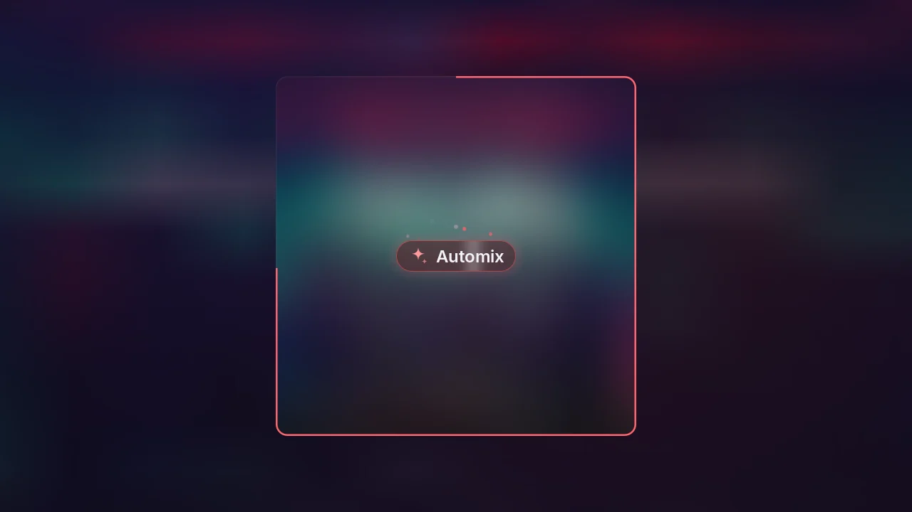 |
| **An Automix playlist, with its joins** | **A Mood playlist** |
| 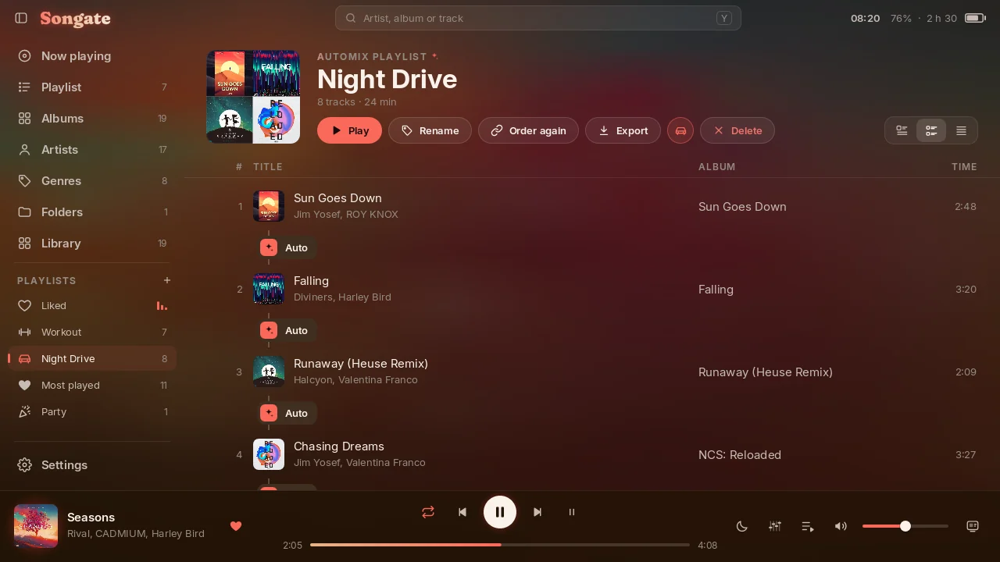 | 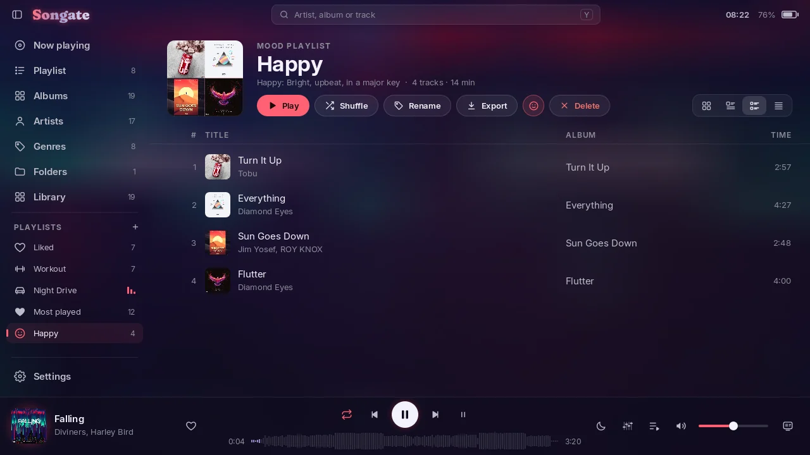 |
| **Albums** | **An album's page** |
| 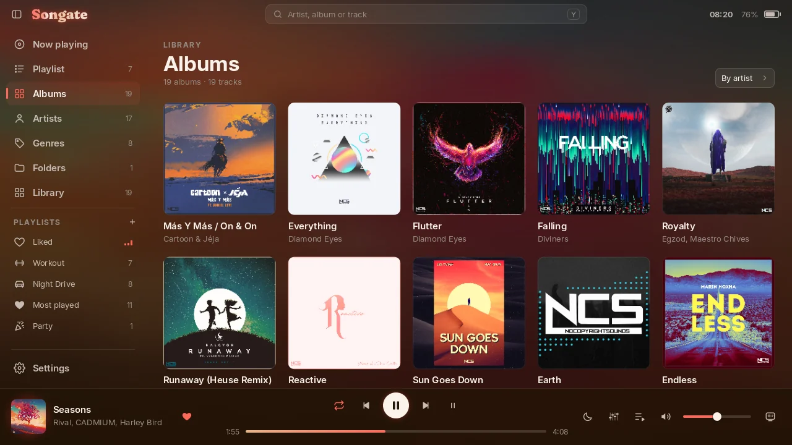 |  |
| **Artists** | **Genres** |
|  | 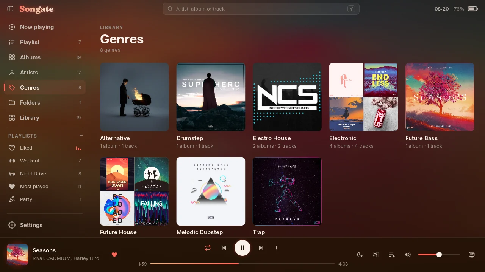 |
| **Library → Tracks, with the letter index** | **The track menu** |
|  |  |
| **Playlists** | **New playlist** |
| 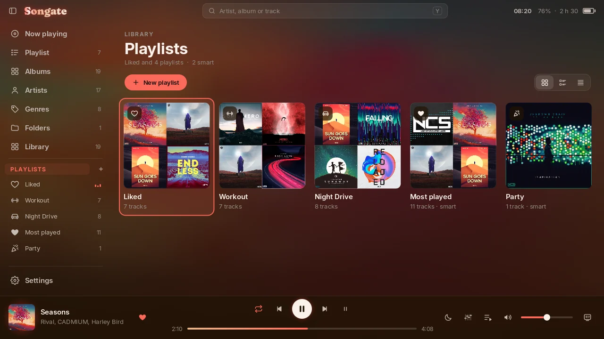 | 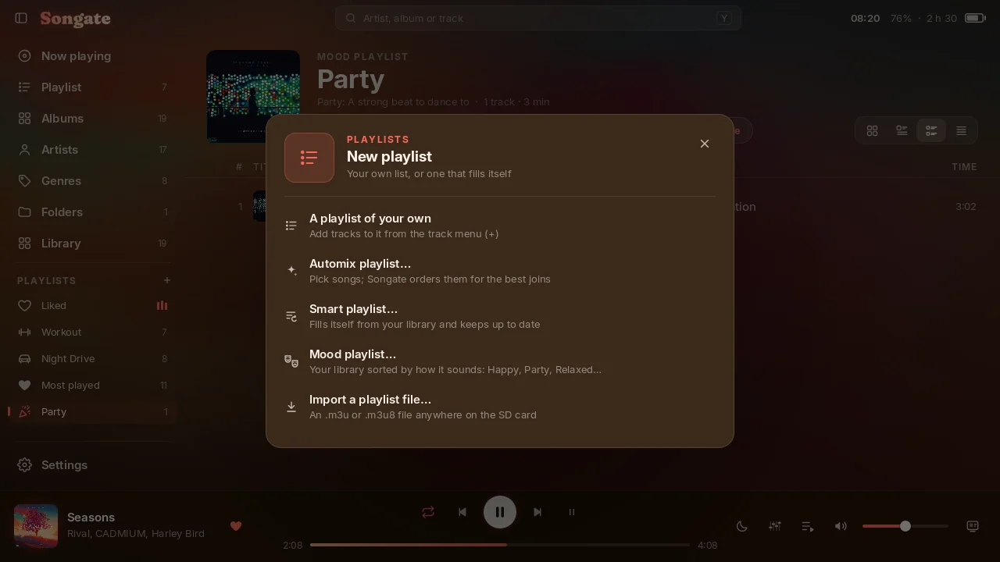 |
| **A smart playlist** | **Liked** |
|  | 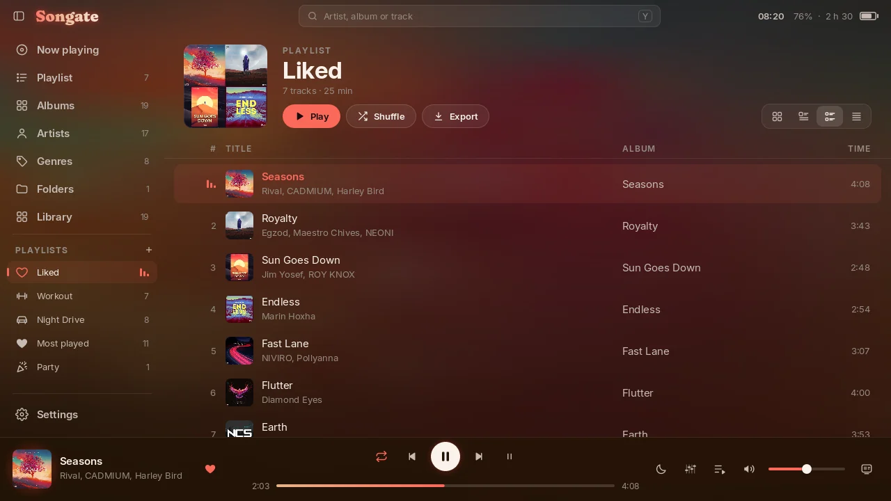 |
| **From the cover, on a light background** | **The cover's palette: its colours and the role each plays** |
|  |  |
| **Appearance** | **Playback** |
|  |  |
| **Equalizer** | **The sleep timer** |
| 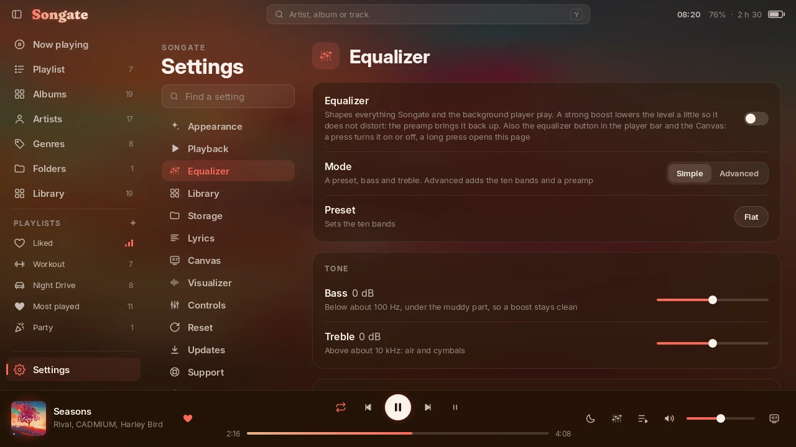 |  |
| **Updates and Automix models** | **Support** |
| 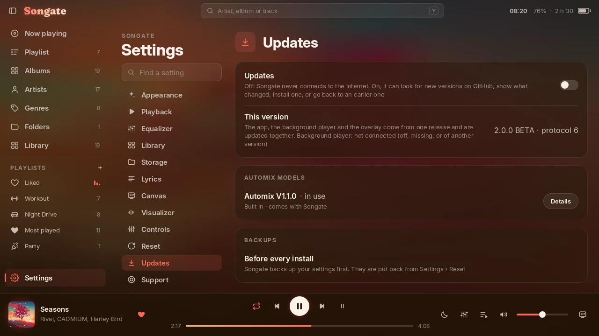 | 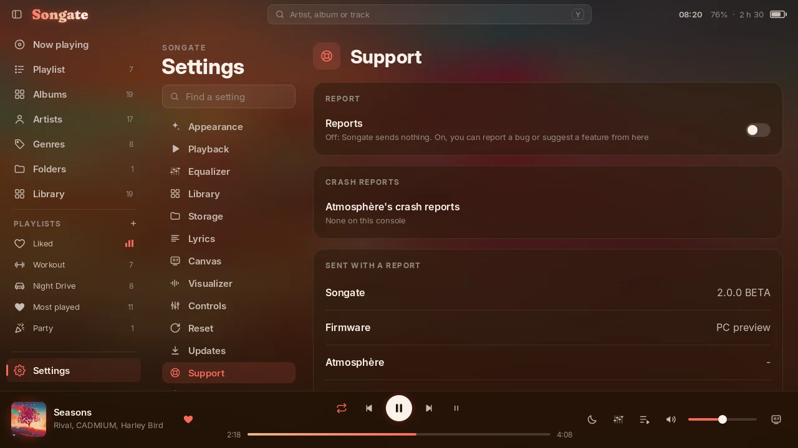 |
| **The guided tour** | |
| 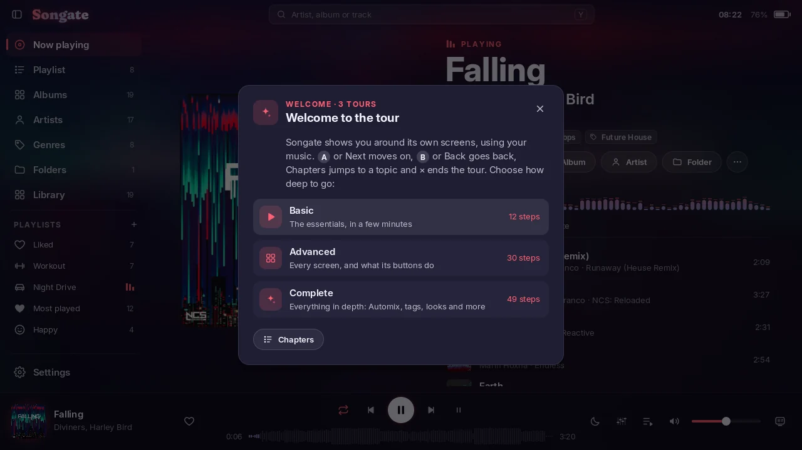 | |

<sub>The screenshots and the tour video come from the PC preview (see below). The music is from NCS (NoCopyrightSounds), [ncs.io](https://ncs.io): see [Credits](#-credits-and-licences).</sub>

---

## 💻 Songate for PC

The same app on Windows, from the same code: the library, playlists, Automix, Mood, the equalizer, lyrics and the Canvas all work as they do on the console. **Tests were only made on Windows 11.**

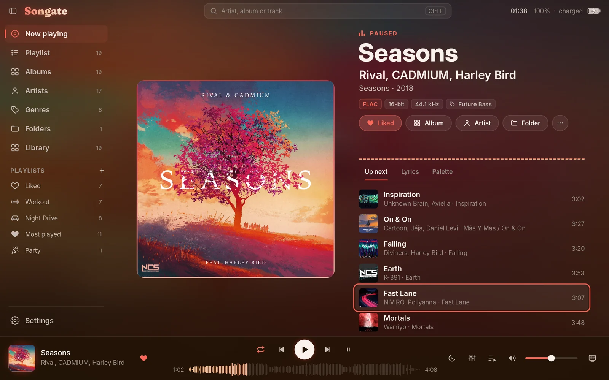

- ⌨️ **Keyboard and mouse.** Space plays and pauses, Ctrl F searches, C opens the Canvas, right-click opens the track menu. Settings → Controls lists every key.
- 🪟 **A real window** that keeps the interface sharp at any size, on high refresh rate screens too. F11 or Alt Enter for full screen. The window's close, minimise and full screen buttons appear when the mouse reaches the top left corner.
- 🔽 **Keep playing when the window closes.** Songate stays by the clock, playing, and its icon brings it back (Settings → Playback).
- ▶️ **Media keys and Windows' media controls.**
- 📁 **Settings are in `%APPDATA%\Songate`.** Uninstalling leaves them there.

**Not on the PC:** the background player, the overlay, game actions and per-game volumes. They belong to the console.

**Not tested yet:** game pads, a second monitor, taskbar buttons, Sleep now, the colour picker, and an in-app update from a real release. If you try them, please [say how it went](../../issues/new/choose).

The sections below describe the console. The PC's differences are the ones listed here.

---

## 🎵 Now playing

- 💿 A large cover that crossfades between tracks and breathes gently with the bass (the strength is a setting, down to off).
- 🏷️ Title, artist and album with year, format chips (codec, bit depth, sample rate, bitrate) and the genre, which opens its page.
- ❤️ Add to Liked, Album, Artist, Folder and the ⋯ track menu.
- 📊 A live spectrum, ported from Gatefold's `viz.js` and `spectrum-worker.js`.
- 📑 Three tabs: **Up next**, **Lyrics** and **Palette** (the cover's colours and the roles they play).
- ⏱️ Lyrics running early or late? Earlier and Later fix them for that track.
- 🎚️ The player bar has the playback order (default, repeat playlist, repeat track, shuffle), previous / play / next, stop after this track, a waveform seek bar, the sleep timer, the equalizer button, the queue, volume and the Canvas button.

## 🖼️ Canvas

- 🧭 **Cover**, **Lyrics** and **Minimal** layouts. Changes animate: the cover glides and the text crossfades.
- 🎼 A track without lyrics switches to Minimal by itself and goes back to your layout with the next track that has some.
- 🌫️ A drifting blurred backdrop, with an optional slow float and Ken Burns zoom on the cover.
- 💤 After a few seconds without input the controls fade away and the progress line rises into a spectrum. Any button brings them back.
- 📜 Lyrics scroll by touch or the right stick. After four seconds they return to the line playing.
- 🌙 The sleep timer's moon is there too, with the time left.

## 🎚️ Automix

An Automix playlist plays like a DJ set. Create one with + in the sidebar → **Automix playlist…**, then tick tracks, albums, artists, genres or folders.

- 👂 **It listens first.** Each song is analysed once on the console: tempo, beats and bars, key, bass, drops, fades and levels.
- 🔀 **It finds the order.** Songs are placed where they join best, and ordered again as you add more. Move one by hand and your order stays until **Order again**. **Play this first** pins the opener. Automix playlists never shuffle: their order is the point.
- 🎛️ **It plans each join:** on the drop, a bridge between tempos, by the songs' structure, or a smart crossfade, with the bass changing hands so two basslines never fight.
- ✨ **A show for each join.** The cover frosts over with Automix's hint. Settings → Appearance → Automix chooses how it looks: Full, Immersive or Simple on Now playing, Full or Simple on the Canvas.
- 🎧 **In the background too.** The background player plans and plays the same joins, in games and with Songate closed.
- 📦 **Models.** Automix's decisions are a versioned model. V1.0.0 and V1.1.0 are built in, and Settings → Updates can bring new ones over the air, checked by size and checksum. You can always go back.

The analysis, the planner, the models and the training tools are open source in **[songate-automix](https://github.com/AndryTheBeast/songate-automix)**, where anyone can train a model of their own.

## 📚 Library

- 💽 **Albums**, **Artists** and **Genres**, built from the tags (album, album artist, artist, track number, year, genre). Several genres per track are split on ";". Artist and genre pages switch between their albums and their tracks (a genre also lists its artists), with the four list views for tracks.
- 🔤 **Library → Tracks** lists every song. Sort it by artist, title, album, year, genre or length, either way round. Filter it by the field you sort by, and jump with the letter index down the side.
- 🗂️ **Folders**: browse the music folder as a tree, then play or shuffle any folder, or add it to the sidebar as a playlist that follows the folder.
- 💾 **Files**: a browser of the whole SD card, off until you show it in Settings → Appearance → Sidebar. An image can become a cover, an `.lrc` a track's lyrics, an `.m3u8` a playlist. It also renames, copies, moves and deletes, one file or several.
- 📋 **Four list views**, as in Gatefold 1.4.2: by album, with covers, as tiles, or as a plain list. Every list remembers its own.
- 📊 **Play statistics.** A track counts as played after a minute (or nearly all of a shorter one), in Songate and in the background player. Plays, last played and date added show in the track's Details. They are kept by Songate; your files are not changed.
- 🧾 **Editing the queue.** On the Playlist view and in Up next, the track menu has Play next, Move (the row is picked up and the D-pad moves it) and Remove, and Clear empties the queue, the track playing too.
- 🔍 **Search** with the console keyboard (Y): title, artist, album and path.
- 🔄 **Resume where you left off**: the queue comes back after a restart, paused at the same place.

## 🎶 Playlists

Everything starts from + next to PLAYLISTS in the sidebar. Tap the PLAYLISTS heading for a page of them all, and Move puts them in your order.

- ❤️ **Liked** and **your own playlists**, made from the sidebar or the track menu, renamed and deleted as you like.
- ✨ **Smart playlists**, as in Gatefold 1.4: Recently added, Most played, Recently played, Forgotten favourites, Never played, a genre, a decade, long tracks. Each has one setting, shows how many tracks match before you create it, and keeps itself up to date.
- 🎭 **Mood playlists:** Happy, Party, Relaxed, Sad or Aggressive. Songate measures each song on the console with its own analysis (energy, beat, brightness, key), so the list fills in as it goes, and each mood wears its own icon.
- 🎚️ **Automix playlists:** [see above](#%EF%B8%8F-automix).
- 🖼️ **78 icons**, shown in the sidebar even when it is folded.
- 📄 **M3U:** import an `.m3u` or `.m3u8` from the card, and export any playlist for other players.
- 🎮 **Playlists for games:** a playlist can start by itself when a game opens, on the HOME menu, back in the game or when it closes, where it was left or shuffled afresh.

## 🎛️ Sound

- 🎚️ **Equalizer.** Simple mode gives you a preset plus bass and treble; Advanced adds ten bands and a preamp. Save your own sounds under a name. The player bar's button turns it on and off, and a long press opens its settings. It works in the background player too.
- 🌊 **Crossfade.** 2 to 12 seconds, and optionally not between tracks of one album, so live albums stay seamless. A track changed by hand fades in 0.3 s.
- 📏 **Volume levelling.** Every track's loudness is measured on the console as ITU-R BS.1770 / EBU R128 measure it (ported from Gatefold 1.4's own meter), with its true peak. Off (the default), Track, Album, or Auto (album, but track while shuffling), to a target of −18, −14 or −11 LUFS. Quiet tracks are raised only as far as their peaks allow. It runs in the background while Songate is open, the track playing and the next ones first, then the whole library, once. The background player levels with the same measurements.

## 🌙 Sleep timer

- ⏲️ 15, 30, 45, 60 or 90 minutes, or the end of the track: from the moon in the player bar, the Canvas or Settings → Playback, and as Sleep Timer in the overlay.
- 🌫️ The music fades out over its last ten seconds and pauses where you were. The background player keeps the time, so it works with Songate closed too.
- 😴 With Songate open, a card then counts down and puts the console to sleep, unless you stay awake (or turn it off in Settings).
- 🔆 **Keep the console awake:** while Songate is open the screen does not dim and the console does not sleep by itself, with an optional dimming of the screen after a few minutes without input.

## 🎨 Appearance

- 🌈 Themes: **From the cover** (on a dark or a light background), **Dark**, **Light**, or **Custom** (your background and two accents, with a colour picker).
- 🎛️ Saturation, colour transition time, and the cover's palette.
- 🧱 A collapsible sidebar: reorder its tabs, hide any but Now playing, and add dividing lines.
- 🔋 The battery in the title bar shows when it is charging, and how long to full or to empty (each can be hidden).
- 📈 Visualizer settings: sensitivity, smoothing, number of bars (for Now playing and the Canvas separately), peak caps and the cover's bass pulse.

## ✏️ Track menu

Press **+** on any track, or ⋯ on Now playing:

- ▶️ Play next, add to the queue, add to a playlist, like.
- 🏷️ **Edit tags** (title, artist, album, album artist, genre, year, track number) and **change the cover** with any image on the SD card, for one track or the whole album. Your changes are kept by Songate in `sdmc:/config/gatefold-nx/` and can be undone. Your music files are never modified.
- 🧭 Go to the album, artist, genre or folder, show the details (with plays and loudness), or delete the file (after asking).

## 🎧 Background player

An optional sysmodule plays the music outside Songate: on the HOME menu, during games, and after Songate is closed. While it runs it does all the playback and Songate becomes its remote, so closing Songate never interrupts the song.

- 🎵 M4A (AAC) with its own small decoder (Helix), plus MP3 and FLAC, gapless, at its own volume, with crossfade, the equalizer and Automix joins.
- 🎮 **Game actions.** For *Game Opens*, *HOME Menu*, *Back to the Game* and *Game Closes*, choose Nothing, Play (a random folder of your music, shuffled), Resume, Pause or one of your playlists, each with a fade. A fresh launch and a return from HOME are told apart, so going HOME and back never reshuffles.
- 🔊 **Per-game volume.** The game running now keeps its own music volume, and every other game shares one.
- 💾 **The queue is kept** across restarts (`bg-session.txt`).
- 📊 It counts plays and keeps the sleep timer while Songate is closed, and levels the volume with Songate's measurements.
- 🖼️ **Covers for the overlay.** Songate makes small copies at the overlay's exact size, because an overlay cannot decode large JPEGs. They are made for every queue sent to the player, or for the whole library at once. If many are missing, Songate offers to make them, and a card in the sidebar shows the progress.

## 🧩 Overlay

`Songate.ovl` for **Ultrahand**, in the style of sys-tune 2.1, on which it is built:

- **Player page:** the cover, title and artist, a seek bar (A picks it up, so the D-pad never scrubs by accident), and shuffle / previous / play / next / repeat.
- **Settings page** (D-pad right): Songate's queue, the music volume, the running game's volume (shown under the game's own name), the volume for every other game, the game actions and their fades, the equalizer and its presets, the sleep timer, and stop after this track.
- **Browse:** your **Folders**, or your **Playlists** by kind, Normal, Smart, Mood and Automix, each with Songate's own icons. Play from any track, or add one or all to the queue. With shuffle on, a folder played or added is shuffled; an Automix playlist always plays in its own order.

Open it with Ultrahand's combo (L + D-pad down + R3, a click of the right stick, unless you changed it).

| Player | Queue, browse and volumes | Game actions | The queue |
|:---:|:---:|:---:|:---:|
|  |  |  |  |
| **Equalizer** | **Browse** | **Playlists by kind** | **Presets** |
| 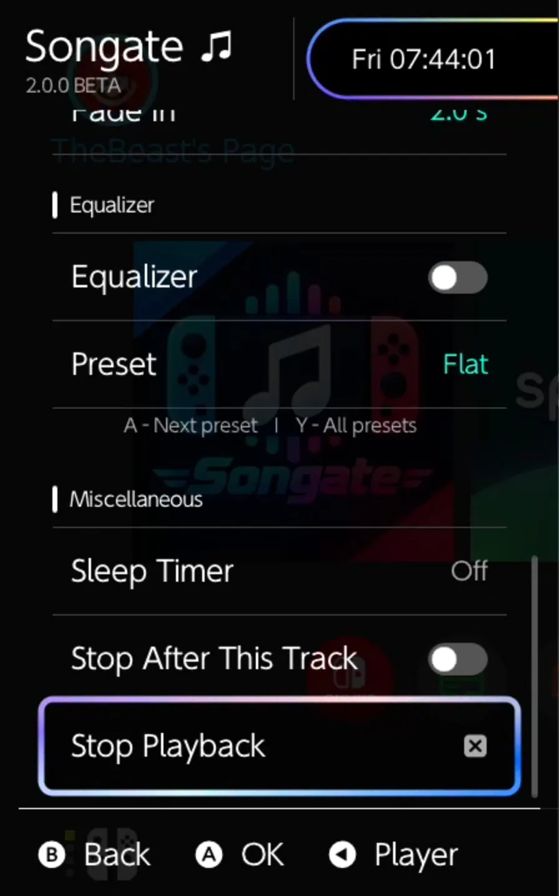 | 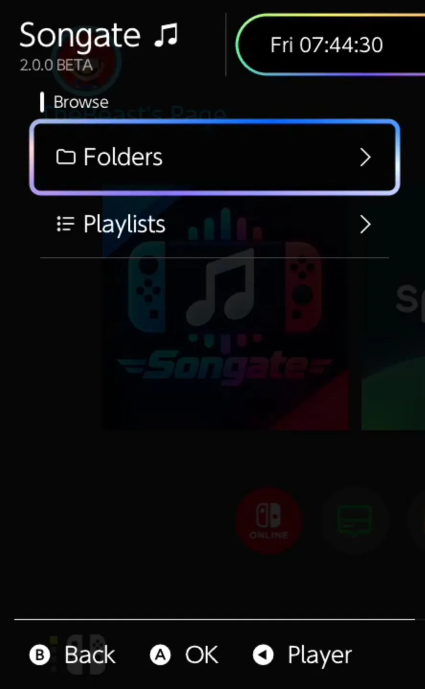 | 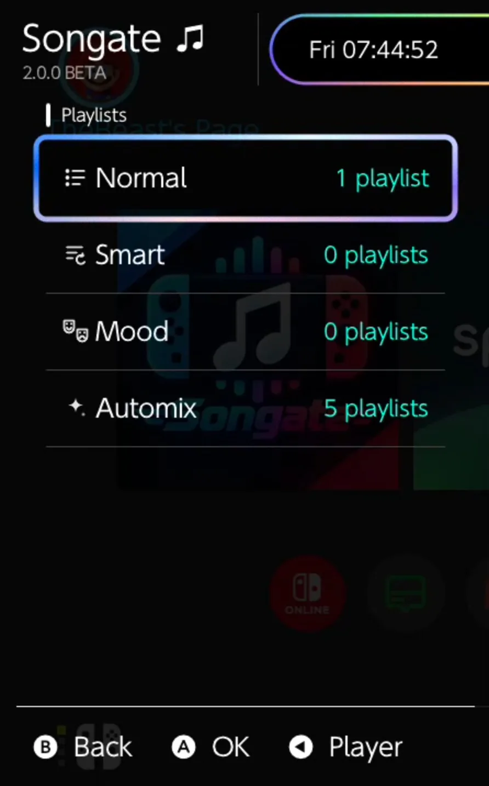 | 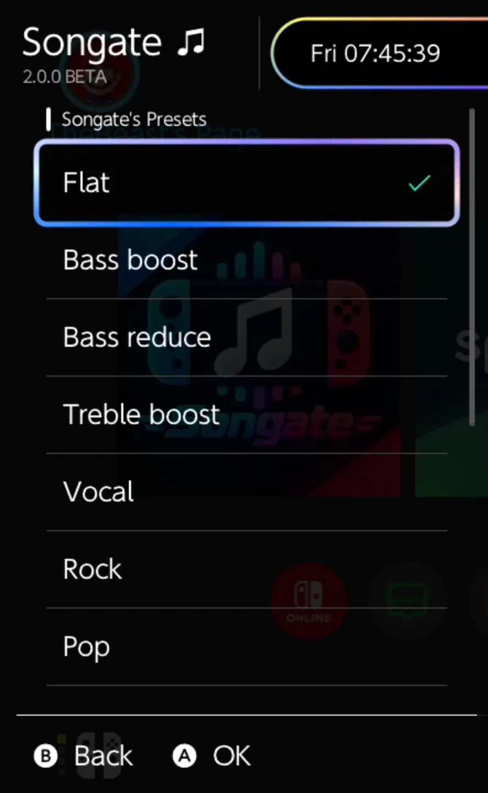 |

<sub>The overlay on a real console, over the HOME menu.</sub>

## ⚙️ Settings, updates and support

- 🔎 **Find a setting** searches every option by name.
- 🗃️ **Storage:** where each browser opens, where backups go, and what Songate keeps on the card, each with its size and a Clear button.
- 🛟 **Backups and resets.** Back up the settings whenever you like, and Songate backs up by itself before every update. Reset puts every setting back as it came, and Factory reset erases what you choose, or everything.
- ⬆️ **Updates** stay off until you turn them on; with them off, Songate never goes online. Then it can check GitHub for new versions, show what changed, install one, or go back to an earlier one, with all three parts always from the same release. **Beta versions** are a separate switch: they can have bugs, so please report what you find.
- 🐞 **Support** stays off until you turn it on. Then you can report a bug or suggest a feature from the console, with what helps to fix it: your Songate and firmware versions and, if you agree, recent crash reports. Never your file names.
- 🧭 **The tour** is in Settings → About: **Basic** (12 steps), **Advanced** (30) or **Complete** (49).

---

## 🎮 Controls

| Button | Action |
|---|---|
| D-pad | Move focus (sidebar, content and player bar) |
| Left stick | A pointer: A taps and drags under it (speed and acceleration in Settings → Controls) |
| A | Select. On a slider or seek bar, pick it up so ←/→ move it (A or B puts it down) |
| B | Back. In Settings' options, back to the category list |
| X | Play / pause |
| Y | Search |
| L / R | Previous / next track |
| ZL / ZR | Seek −10 / +10 s |
| − | Canvas (full screen) |
| + | Track menu |
| Right stick | Scroll |
| HOME | Leave Songate (close it from the HOME menu) |

👆 Touch works everywhere: tap, drag lists with momentum, and drag the seek bar and the volume. A USB mouse works too.

## 💾 Installation

### 🎮 On the Switch

You need a Switch running **Atmosphère**, and **Ultrahand** for the overlay. **Tests were only made on HOS 22.5.0 and 23.0.0, with the latest HATS pack from sthetix.**

Download `SongateNX-<version>.zip` from [Releases](../../releases) and unzip it onto the root of the SD card. It holds:

| Path | What |
|---|---|
| `switch/Songate/Songate.nro` | 🎵 the app |
| `atmosphere/contents/4200000047464E58/exefs.nsp` | 🎧 the background player (sysmodule) |
| `atmosphere/contents/4200000047464E58/flags/boot2.flag` | starts it at boot |
| `atmosphere/contents/4200000047464E58/toolbox.json` | lets sysmodule managers list it |
| `switch/.overlays/Songate.ovl` | 🧩 the overlay |

🙈 **Can't find the overlay?** `switch/.overlays` is a hidden folder (its name starts with a dot): macOS and many phone file and zip apps hide it, and some leave it out when copying. Copy the whole `switch` and `atmosphere` folders from the zip, and on a Mac press ⌘ ⇧ . in Finder to see hidden folders. The overlay shows up in **Ultrahand**, which must be installed.

🔁 **Coming from Gatefold NX 1.x?** Unzip over it. Your settings stay in `sdmc:/config/gatefold-nx/`, and the first start removes the old `.nro` and overlay.

**Restart the console** after installing or updating the background player, because sysmodules load at boot.

▶️ **Launch Songate by holding R while starting a game** (title override). Applet mode, from the Album, has too little memory and no keyboard.

📁 Put your music anywhere on the card. On first start a folder called `Music` at the top of the card is used; otherwise a folder picker opens (Settings → Library → Music folder changes it). Settings, playlists, Liked, your edits and the caches are kept in `sdmc:/config/gatefold-nx/`.

The app and the overlay work without the background player. Without it, or with *Keep playing outside Songate* turned off, Songate plays by itself and the music stops when you leave it.

### 💻 On Windows

You need a 64-bit PC. **Tests were only made on Windows 11.**

Download `SongateWIN-<version>.exe` from [Releases](../../releases) and run it. It needs no administrator rights: you choose a folder, which shortcuts you want, and whether to open Songate at the end. Windows' protected folders, like Program Files, can't be used. Settings › Updates installs newer versions, once you turn it on.

🛡️ **"Windows protected your PC"?** The installer isn't signed, so Windows doesn't know it yet. Click **More info**, then **Run anyway**. Your browser may also ask whether to keep the download. The release notes list the file's SHA-256, if you'd like to check it first.

📁 At the first start, choose your music folder (Settings → Library → Music folder changes it).

## 🎼 Formats

**Supported: MP3, M4A (AAC) and FLAC.** These are the formats Songate is tested with, in the app and in the background player.

- **Every other format is unsupported.** Some of them may play (WAV; in Songate only, also ALAC, Ogg Vorbis and Opus), but they are not tested. If you run into a problem with one, you can still [open an issue](../../issues).
- **Covers:** embedded art, your own cover from the track menu, or `cover` / `folder` / `front` (.jpg, .png) in the track's folder.
- **Lyrics:** an `.lrc` (or `.txt`) file with the track's name beside it, or the LYRICS / USLT tag.

## ⚡ Performance

- 🚀 **Fast launch.** The music folder's file list is remembered and checked again in the background, so launch doesn't wait for the SD card. Fonts are read into memory once, and the tag cache is read in one pass.
- 🖼️ **Cover cache.** Every cover is kept as a small JPEG (one per distinct picture), so lists open with their covers ready. The cache fills in the background after the tags, and again for new music after a rescan.
- 🧵 **Multi-core.** The main thread keeps core 0. Audio, the track loader and file writing run on core 1, tags and covers on core 2, each with its own priority so nothing visible waits for background work.

---

## 🛠️ Building

Requires [devkitPro](https://devkitpro.org/wiki/Getting_Started) with Switch support:

```bash
dkp-pacman -S switch-dev switch-sdl2 switch-sdl2_mixer switch-sdl2_ttf switch-sdl2_image switch-ffmpeg switch-libjpeg-turbo
```

```bash
make                     # the app: Songate.nro (fonts and icons ship inside it, in RomFS)
make clean && make DEV=0 # the app as released, without the testing extras (Settings → Debug)
make -C sysmodule        # the background player: gatefold-bg.nsp
make -C overlay          # the overlay: Songate.ovl
```

`tools/bgtest/` runs the background player's decoders on a PC, to compare them with FFmpeg.

### 💻 Windows

`tools/windows/` builds Songate for PC from the same `source/`, with clang and CMake. `build-deps.sh` builds the libraries, `build.sh` the program, and `package.sh` the installer with Inno Setup.

### 🖥️ PC preview

`tools/preview/` builds the same UI code for Windows against a small stand-in for libnx, with a fake SD card. It reads WAV, plus M4A and FLAC when built with FFmpeg. It runs hidden, takes scripted input, and saves screenshots: every screenshot above comes from it.

```bash
python tools/preview/make_demo.py <folder-with-jpg-covers> <demo-root>
```

```bash
FFMPEG=<FFmpeg win64 shared build> bash tools/preview/build.sh <folder-with-SDL2-devel-VC-packages>
```

Run `gatefold-preview.exe` with the variables described at the top of `tools/preview/hostshim.cpp`:

- `GF_ROOT=<demo-root>` points it at the fake SD card.
- `GF_SHOW=1` opens a window you drive with the keyboard.
- `GF_SCRIPT=<file>` replays scripted input and takes screenshots.

The preview is a dev build; `DEV=0` before `bash tools/preview/build.sh` builds it as a release looks, as for the screenshots above. `tools/preview/record.py` records it with buttons alone, from `tour-film-1.txt` and `tour-film-2.txt`, and `make_film.py` cuts the tour video.

## ⚠️ Known limits

- **Formats:** only MP3, M4A and FLAC are supported and tested. Others may play but are untested; the background player skips ALAC, Ogg Vorbis and Opus.
- **Firmware:** tests were only made on HOS 22.5.0 and 23.0.0, with the latest HATS pack from sthetix.
- **Windows:** tests were only made on Windows 11. The installer isn't signed.
- **Not ported:** Gatefold's radio, YouTube, and online cover and lyrics lookup.
- **Scripts:** CJK text uses the console's own fonts; scripts outside them will not render.
- **MP3 durations:** VBR MP3s without a Xing header get an estimated duration.

## 📜 Licence

Songate's own code (the app, the background player and the tools) is under the **MIT licence** (`LICENSE`), like Gatefold itself. The **overlay** (`overlay/`) is under the **GPL 2**, because it is built on sys-tune and libultrahand (`overlay/LICENSE-sys-tune`). The third-party code and assets listed below keep their own licences.

## 🙏 Credits and licences

- 🎨 **[Gatefold](https://github.com/DEVIROYrus/gatefold-foobar2000)** by **[DEVIROYrus](https://github.com/DEVIROYrus)**: the foobar2000 interface Songate began as a recreation of, with its design, palette algorithm and icons. © Gatefold contributors, MIT licence (`LICENSE-gatefold`).
- 🔤 **Inter:** the typeface. © The Inter Project Authors, SIL Open Font Licence (`romfs/fonts/OFL.txt`). **Fraunces:** the Songate wordmark, SIL Open Font Licence (`tools/brand/OFL.txt`).
- 🎞️ **FFmpeg** (LGPL 2.1), **SDL 2** with SDL_mixer, SDL_ttf and SDL_image (zlib), **libFLAC**, **mpg123**, **Opus**, **Tremor** and **libjpeg-turbo**, through devkitPro's portlibs. **stb_image** (public domain / MIT).
- 🧰 **libnx and devkitPro:** the Switch homebrew toolchain (ISC).
- 🪟 **On Windows:** the same libraries built by `tools/windows`, plus **curl** and **zlib**, as listed in the `licences` folder beside the program. FFmpeg and mpg123 are separate DLLs you may replace.
- 🎧 **Background player:** the Helix fixed-point AAC decoder © RealNetworks, RPSL (`sysmodule/lib/helix-aac`). Also minimp3 (CC0) and dr_flac (public domain / MIT-0), in `sysmodule/lib/single`.
- 🧩 **Overlay:** built on sys-tune's overlay © HookedBehemoth and ppkantorski, GPL 2 (`overlay/LICENSE-sys-tune`), with libultrahand © ppkantorski and libtesla © WerWolv (`overlay/lib/libultrahand`).
- 🎶 **Music in the screenshots and the tour video:** from NCS (NoCopyrightSounds), [ncs.io](https://ncs.io). Among them: Rival & CADMIUM ft. Harley Bird, *Seasons*; Jim Yosef & ROY KNOX, *Sun Goes Down*; Diviners ft. Harley Bird, *Falling*; Marin Hoxha, *Endless*; K-391, *Earth*. No music is included with Songate.

Songate is an unofficial homebrew project, not affiliated with Nintendo or foobar2000.

## 👥 Authors

- **[AndryTheBeast](https://github.com/AndryTheBeast)**: Songate, the Switch app, background player and overlay.
- **[DEVIROYrus](https://github.com/DEVIROYrus)**: [Gatefold](https://github.com/DEVIROYrus/gatefold-foobar2000), the foobar2000 interface on PC that Songate began as a recreation of.
