<p align="center"></p>
<h1 align="center">Gatefold NX</h1>
<p align="center"><b>Gatefold, the foobar2000 interface, as a native music player for the Nintendo Switch.</b><br>
Your own music folder, synced lyrics, colours from every cover, and music that keeps playing on the HOME menu and in games.<br>
By <a href="https://github.com/AndryTheBeast"><b>AndryTheBeast</b></a> &amp; <a href="https://github.com/DEVIROYrus"><b>DEVIROYrus</b></a> · version 1.1.0<br>
<a href="../../releases/latest"><b>⬇️ Download the latest release</b></a></p>

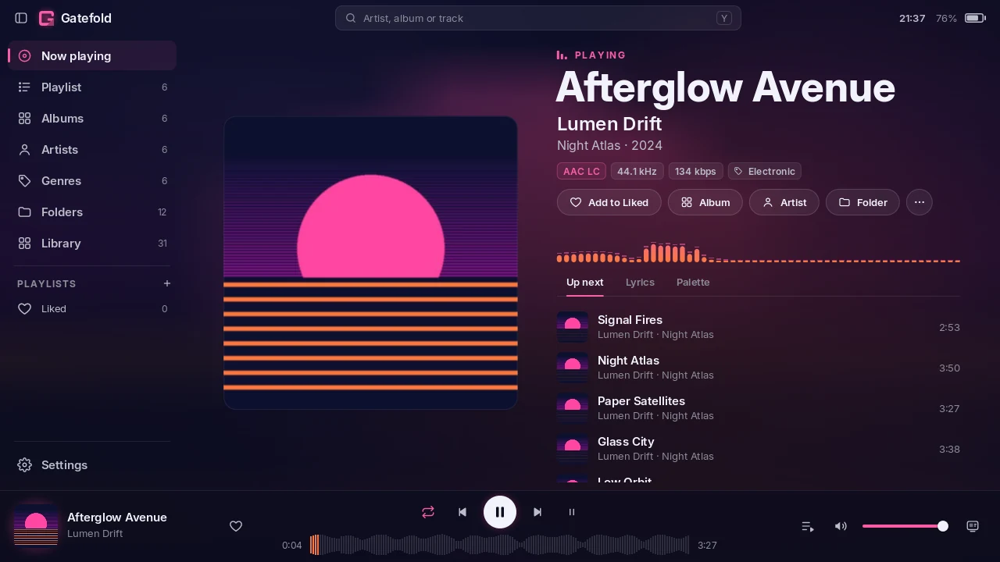

[Gatefold](https://github.com/DEVIROYrus/gatefold-foobar2000), by [DEVIROYrus](https://github.com/DEVIROYrus), is a modern interface for foobar2000 on Windows, written in HTML and JavaScript. **Gatefold NX** is not a port: it is a native rewrite in C++ (devkitPro, libnx, SDL2) that recreates it as closely as the console allows. Layout values come straight from Gatefold's CSS, and CSS pixels map 1:1 onto the Switch's 1280×720 screen. Its icons, typeface and colour algorithm are Gatefold's own.

---

## ✨ Highlights

- 🎨 **Colours from the cover.** The whole interface takes its palette from the album playing, with Gatefold's own algorithm (`palette-core.js`, ported line for line and verified to give identical colours on Gatefold's test covers). Or pick a fixed Dark or Light theme, or your own.
- 🎤 **Synced lyrics.** From `.lrc` files or the lyrics tag, in Now playing and in the full-screen Canvas. They follow the music, scroll by hand, and an instrumental break shows Gatefold's three pulsing dots.
- 🖼️ **Canvas.** A full-screen Now playing with Cover, Lyrics and Minimal layouts. When nothing is touched, the controls fade away and the progress line grows into a spectrum.
- 🎧 **Background player.** An optional sysmodule keeps the music going on the HOME menu, during games and after Gatefold closes, with no gap. An Ultrahand overlay controls it from anywhere.
- 📊 **Play statistics and smart playlists.** Plays are counted, also by the background player, and smart playlists such as Most played, Recently added or Forgotten favourites fill themselves.
- 🌙 **A sleep timer.** The music fades out and pauses, then the console can go to sleep by itself.
- 🔊 **Volume levelling.** Every track about as loud as the next, measured on the console: your files are never changed.
- 📁 **Your music, however it is organised.** One flat folder of 3,000 files, Artist/Album folders, or folders used as playlists: albums, artists and genres come from the tags, never from the layout.
- ⚡ **Fast on the console.** Launches in about a second with a 3,000-track library. Covers and the file list are cached, and background work runs on the console's spare cores.

## 📸 Screenshots

| Now playing · synced lyrics | Canvas |
|---|---|
| 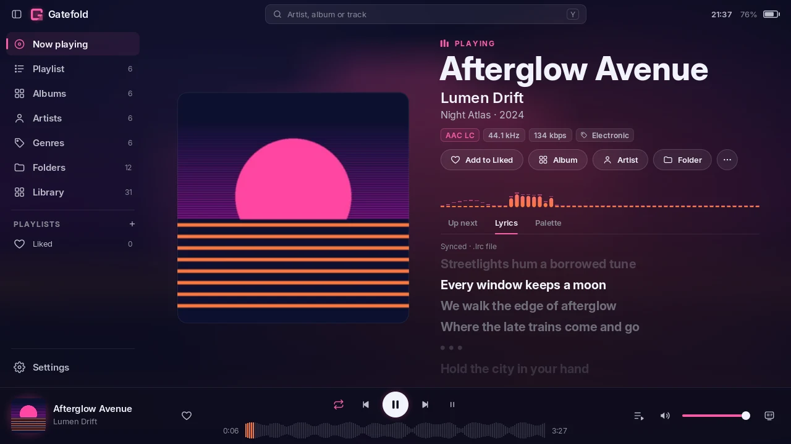 | 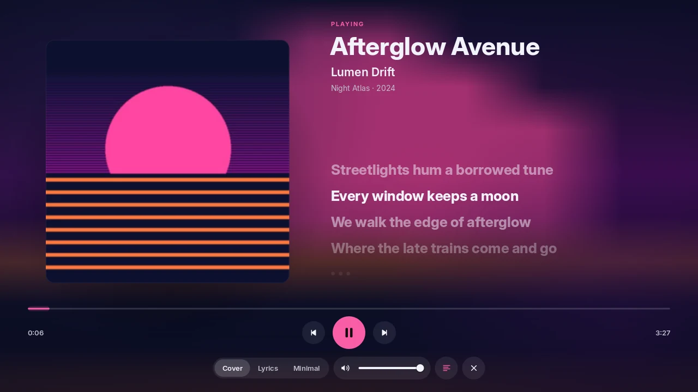 |
| **Canvas when idle: the spectrum** | **Album page** |
| 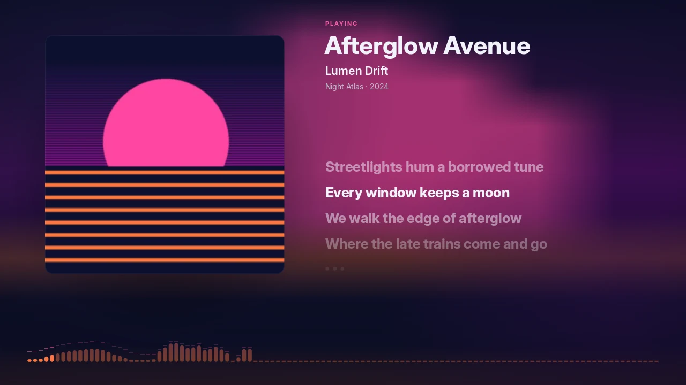 | 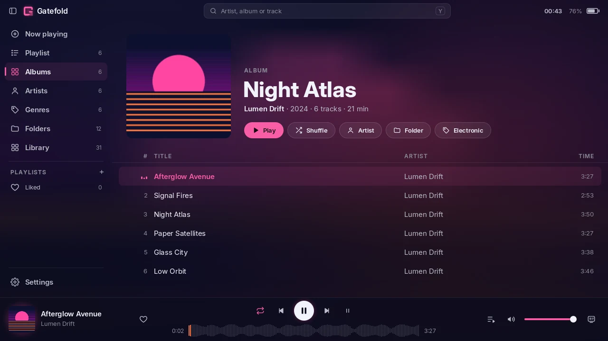 |
| **Library → Tracks, with the letter index** | **Artists** |
| 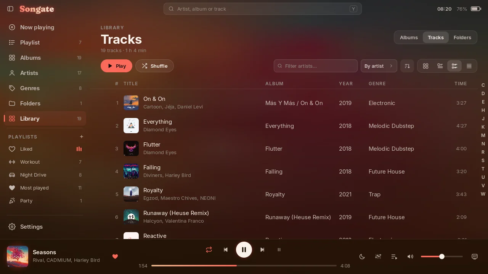 | 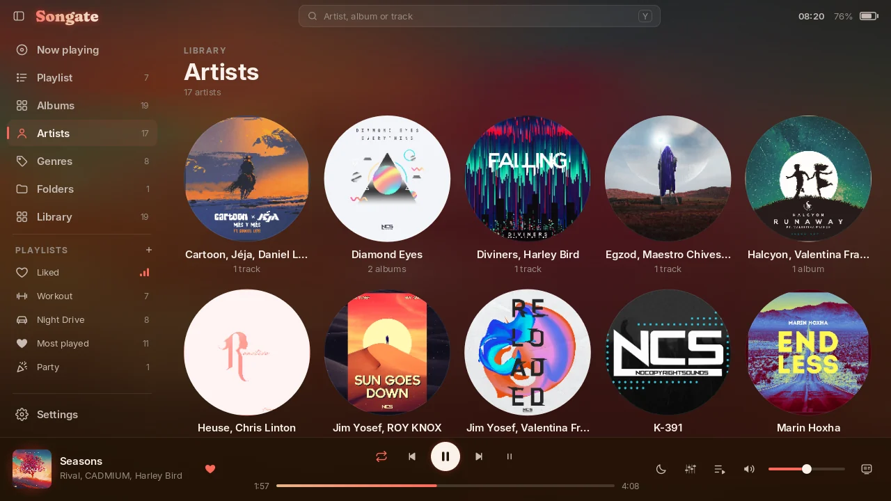 |
| **Settings** | **The track menu** |
| 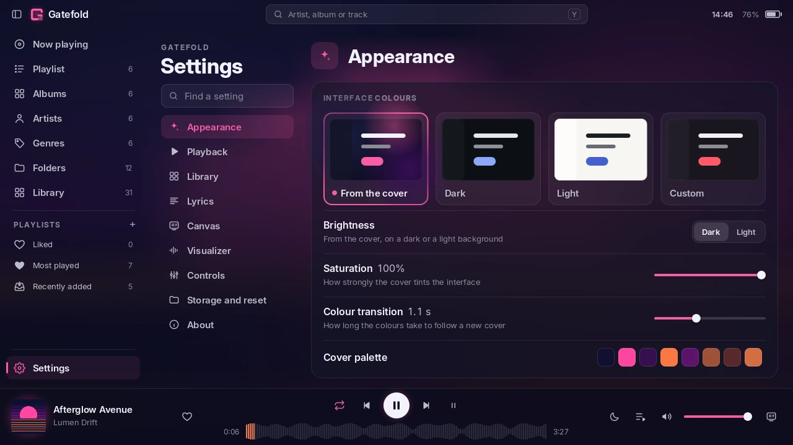 | 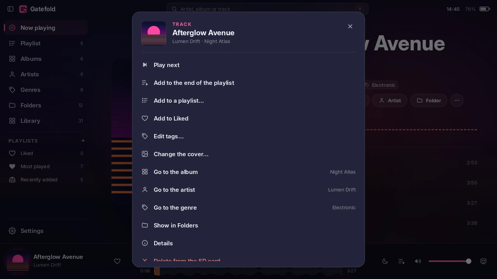 |
| **From the cover, on a light background** | **The cover's palette: its colours and the role each plays** |
| 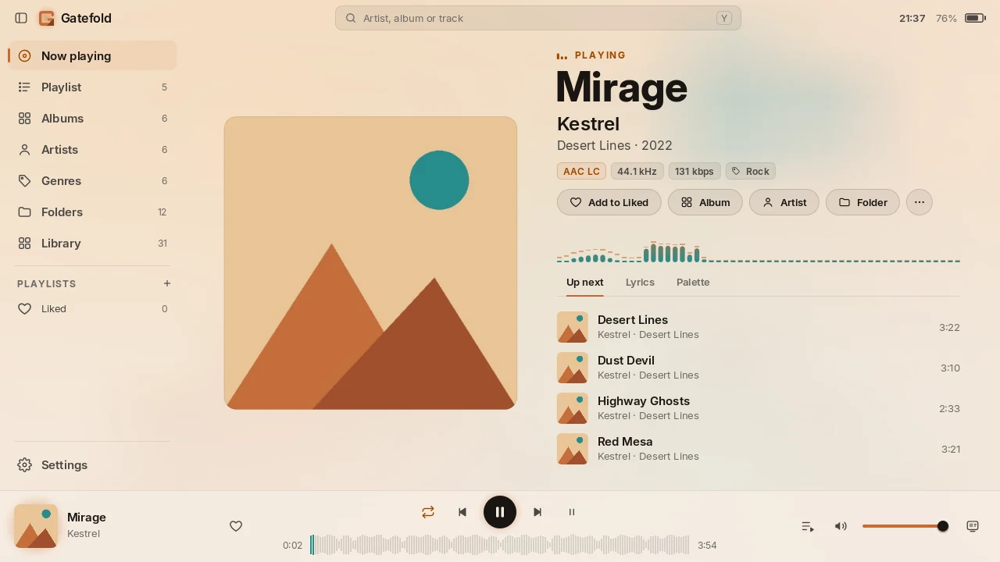 | 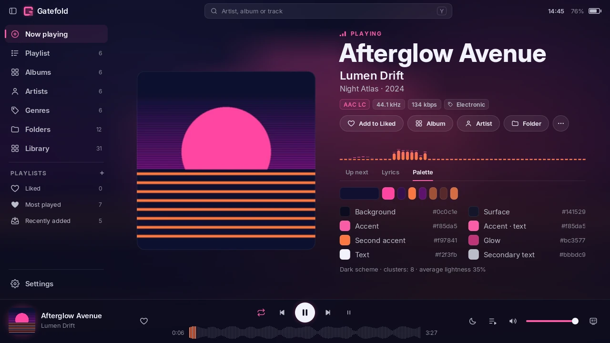 |
| **Smart playlists** | **Editing the queue: a track picked up to move** |
| 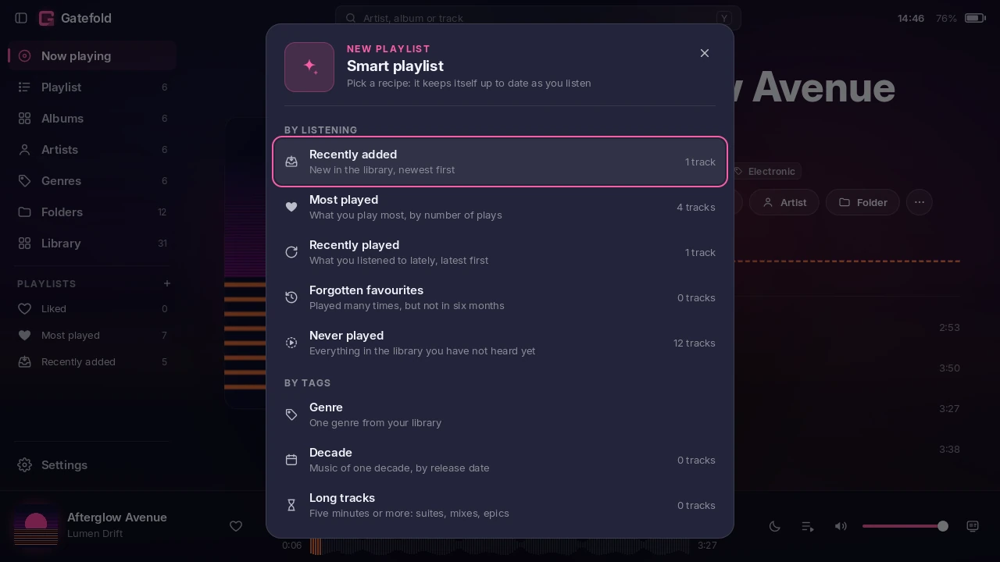 | 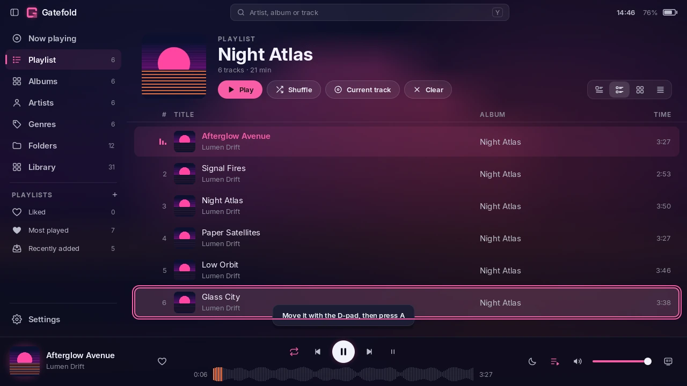 |
| **The sleep timer** | **Volume levelling and sleep in Settings** |
| 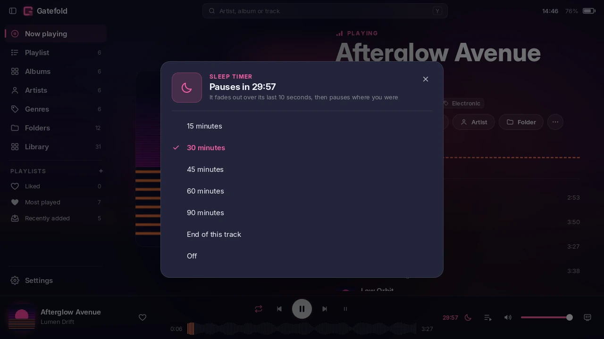 | 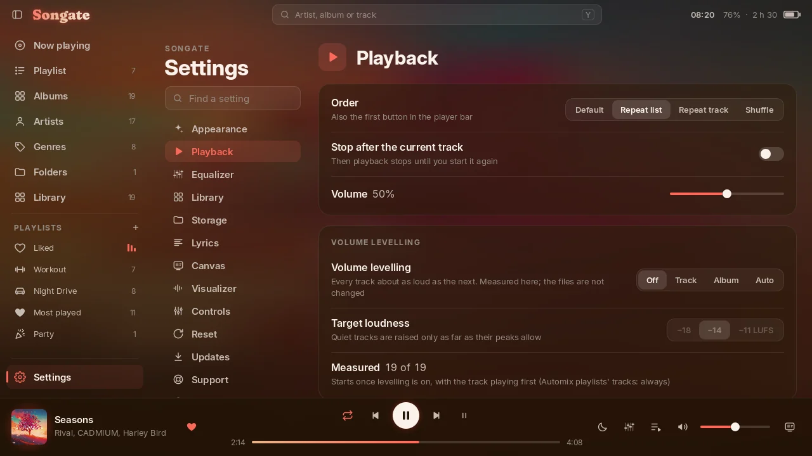 |

<sub>The screenshots come from the PC preview (see below). The artists and albums are made up, and the covers are Gatefold's own test images (MIT licence).</sub>

---

## 🎵 Now playing

- 💿 A large cover that crossfades between tracks and breathes gently with the bass (the strength is a setting, down to off).
- 🏷️ Title, artist and album with year, format chips (codec, bit depth, sample rate, bitrate) and the genre, which opens its page.
- ❤️ Add to Liked, Album, Artist, Folder and the ⋯ track menu.
- 📊 A live spectrum, ported from Gatefold's `viz.js` and `spectrum-worker.js`.
- 📑 Three tabs: **Up next**, **Lyrics** and **Palette** (the cover's colours and the roles they play).
- 🎚️ The player bar has the playback order (default, repeat playlist, repeat track, shuffle), previous / play / next, stop after this track, a waveform seek bar, the sleep timer, volume and the Canvas button.

## 🖼️ Canvas

- 🧭 **Cover**, **Lyrics** and **Minimal** layouts. Changes animate: the cover glides and the text crossfades.
- 🎼 A track without lyrics switches to Minimal by itself and goes back to your layout with the next track that has some.
- 🌫️ A drifting blurred backdrop, with an optional slow float and Ken Burns zoom on the cover.
- 💤 After a few seconds without input the controls fade away and the progress line rises into a spectrum. Any button brings them back.
- 📜 Lyrics scroll by touch or the right stick. After four seconds they return to the line playing.
- 🌙 The sleep timer's moon is there too, with the time left.

## 📚 Library

- 💽 **Albums**, **Artists** and **Genres**, built from the tags (album, album artist, artist, track number, year, genre). Several genres per track are split on ";". Artist and genre pages switch between their albums and their tracks (a genre also lists its artists), with the four list views for tracks.
- 🔤 **Library → Tracks** lists every song. Sort it by artist, title, album, year, genre or length, either way round. Filter it by the field you sort by, and jump with the letter index down the side.
- 🗂️ **Folders**: browse the music folder as a tree, then play or shuffle any folder, or add it to the sidebar as a playlist that follows the folder.
- 📋 **Four list views**, as in Gatefold 1.4.2: by album, with covers, as tiles, or as a plain list. Every list remembers its own.
- 🎶 **Your own playlists**, made with + in the sidebar or from the track menu. They can be renamed and deleted.
- ✨ **Smart playlists** (+ in the sidebar → Smart playlist…), as in Gatefold 1.4: Recently added, Most played, Recently played, Forgotten favourites, Never played, a genre, a decade, long tracks. Each has one setting, shows how many tracks match before you create it, and keeps itself up to date.
- 📊 **Play statistics.** A track counts as played after a minute (or nearly all of a shorter one), in Gatefold and in the background player. Plays, last played and date added show in the track's Details. They are kept by Gatefold; your files are not changed.
- 🧾 **Editing the queue.** On the Playlist view and in Up next, the track menu has Play next, Move (the row is picked up and the D-pad moves it) and Remove, and Clear empties the queue but for the track playing.
- 🔍 **Search** with the console keyboard (Y): title, artist, album and path.
- 🔄 **Resume where you left off**: the queue comes back after a restart, paused at the same place.

## 🌙 Sleep timer

- ⏲️ 15, 30, 45, 60 or 90 minutes, or the end of the track: from the moon in the player bar, the Canvas or Settings → Playback, and as Sleep Timer in the overlay.
- 🌫️ The music fades out over its last ten seconds and pauses where you were. The background player keeps the time, so it works with Gatefold closed too.
- 😴 With Gatefold open, a card then counts down and puts the console to sleep, unless you stay awake (or turn it off in Settings).
- 🔆 **Keep the console awake:** while Gatefold is open the screen does not dim and the console does not sleep by itself, with an optional dimming of the screen after a few minutes without input.

## 🔊 Volume levelling

- 📏 Every track's loudness is measured on the console as ITU-R BS.1770 / EBU R128 measure it (ported from Gatefold 1.4's own meter), with its true peak.
- 🎚️ Off (the default), Track, Album, or Auto (album, but track while shuffling), to a target of −18, −14 or −11 LUFS. Quiet tracks are raised only as far as their peaks allow.
- ⏳ It runs in the background while Gatefold is open, the track playing and the next ones first, then the whole library, once. The results are kept by Gatefold; the background player levels with them too.

## 🎨 Appearance

- 🌈 Themes: **From the cover** (on a dark or a light background), **Dark**, **Light**, or **Custom** (your background and two accents).
- 🎛️ Saturation, colour transition time, and the cover's palette.
- 🧱 A collapsible sidebar, and every tab but Now playing can be hidden.
- 🔋 The battery in the title bar shows when it is charging, and how long to full or to empty (each can be hidden).
- 📈 Visualizer settings: sensitivity, smoothing, number of bars (for Now playing and the Canvas separately), peak caps and the cover's bass pulse.

## ✏️ Track menu

Press **+** on any track, or ⋯ on Now playing:

- ▶️ Play next, add to the queue, add to a playlist, like.
- 🏷️ **Edit tags** (title, artist, album, album artist, genre, year, track number) and **change the cover** with any image on the SD card, for one track or the whole album. Your changes are kept by Gatefold in `sdmc:/config/gatefold-nx/` and can be undone. Your music files are never modified.
- 🧭 Go to the album, artist, genre or folder, show the details (with plays and loudness), or delete the file (after asking).

## 🎧 Background player

An optional sysmodule plays the music outside Gatefold: on the HOME menu, during games, and after Gatefold is closed. While it runs it does all the playback and Gatefold becomes its remote, so closing Gatefold never interrupts the song.

- 🎵 AAC (M4A) with its own small decoder (Helix), plus MP3, FLAC and WAV, gapless, at its own volume.
- 🎮 **Game actions.** For *Game Opens*, *HOME Menu*, *Back to the Game* and *Game Closes*, choose Nothing, Play (a random folder of your music, shuffled), Resume or Pause, each with a fade. A fresh launch and a return from HOME are told apart, so going HOME and back never reshuffles.
- 🔊 **Per-game volume.** The game running now keeps its own music volume, and every other game shares one.
- 💾 **The queue is kept** across restarts (`bg-session.txt`).
- 📊 It counts plays and keeps the sleep timer while Gatefold is closed, and levels the volume with Gatefold's measurements.
- 🖼️ **Covers for the overlay.** Gatefold makes small copies at the overlay's exact size, because an overlay cannot decode large JPEGs. They are made for every queue sent to the player, or for the whole library at once. If many are missing, Gatefold offers to make them, and a card in the sidebar shows the progress.

## 🧩 Overlay

`Gatefold.ovl` for **Ultrahand**, in the style of sys-tune 2.1, on which it is built:

- **Player page:** the cover, title and artist, a seek bar (A picks it up, so the D-pad never scrubs by accident), and shuffle / previous / play / next / repeat.
- **Settings page** (D-pad right): Gatefold's queue, browse and play a folder, the music volume, the running game's volume (shown under the game's own name), the volume for every other game, the game actions and their fades, the sleep timer, and stop after this track. With shuffle on, a folder played or added is shuffled.

Open it with Ultrahand's combo (ZL + ZR + D-pad down unless you changed it).

| Player | Queue, browse and volumes | Game actions | The queue |
|:---:|:---:|:---:|:---:|
| 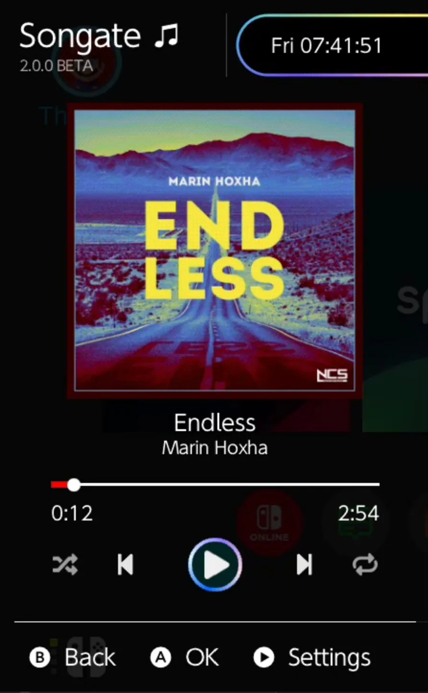 | 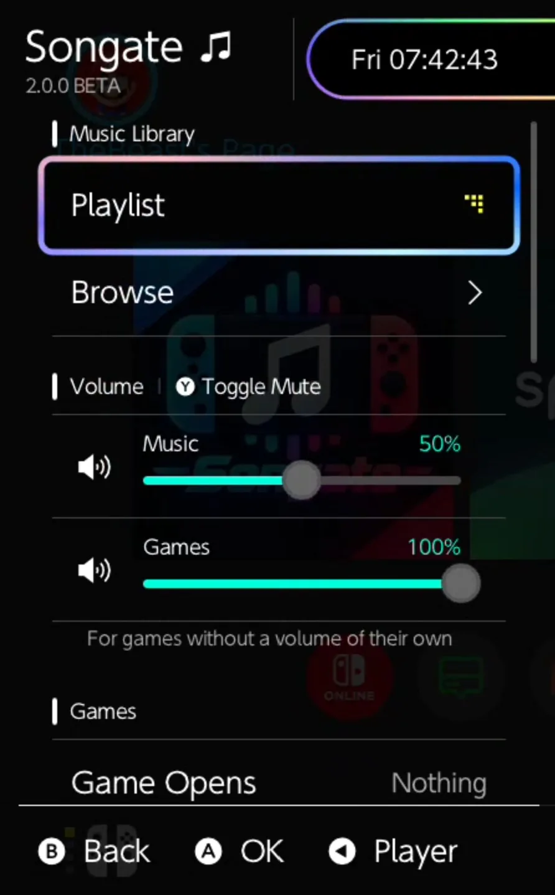 | 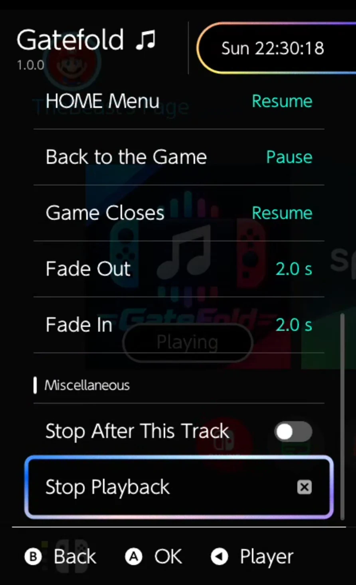 | 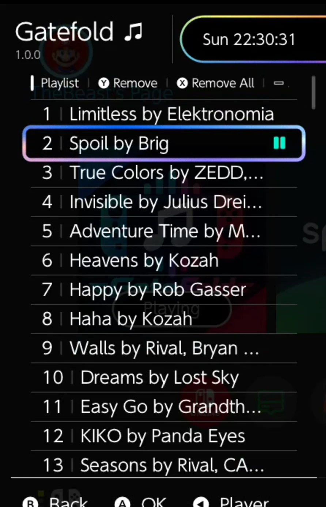 |

<sub>The overlay on a real console, over the HOME menu.</sub>

---

## 🎮 Controls

| Button | Action |
|---|---|
| D-pad | Move focus (sidebar, content and player bar) |
| Left stick | A pointer: A taps and drags under it (speed and acceleration in Settings → Controls) |
| A | Select. On a slider or seek bar, pick it up so ←/→ move it (A or B puts it down) |
| B | Back. In Settings' options, back to the category list |
| X | Play / pause |
| Y | Search |
| L / R | Previous / next track |
| ZL / ZR | Seek −10 / +10 s |
| − | Canvas (full screen) |
| + | Track menu |
| Right stick | Scroll |
| HOME | Leave Gatefold (close it from the HOME menu) |

👆 Touch works everywhere: tap, drag lists with momentum, and drag the seek bar and the volume.

## 💾 Installation

You need a Switch running **Atmosphère**, and **Ultrahand** for the overlay.

Download `GatefoldNX-<version>.zip` from [Releases](../../releases/latest) and unzip it onto the root of the SD card. It holds:

| Path | What |
|---|---|
| `switch/Gatefold/Gatefold.nro` | 🎵 the app |
| `atmosphere/contents/4200000047464E58/exefs.nsp` | 🎧 the background player (sysmodule) |
| `atmosphere/contents/4200000047464E58/flags/boot2.flag` | starts it at boot |
| `atmosphere/contents/4200000047464E58/toolbox.json` | lets sysmodule managers list it |
| `switch/.overlays/Gatefold.ovl` | 🧩 the overlay |

The SD-card layout is in `dist/` once built. **Restart the console** after installing or updating the background player, because sysmodules load at boot.

▶️ **Launch Gatefold by holding R while starting a game** (title override). Applet mode, from the Album, has too little memory and no keyboard.

📁 Put your music anywhere on the card. On first start a folder called `Music` at the top of the card is used; otherwise a folder picker opens (Settings → Library → Music folder changes it). Settings, playlists, Liked, your edits and the caches are kept in `sdmc:/config/gatefold-nx/`.

The app and the overlay work without the background player. Without it, or with *Keep playing outside Gatefold* turned off, Gatefold plays by itself and the music stops when you leave it.

## 🎼 Formats

- **In Gatefold:** M4A / MP4 (AAC, ALAC) through FFmpeg, and FLAC, MP3, Ogg Vorbis, Opus and WAV through SDL_mixer.
- **In the background player:** AAC, MP3, FLAC and WAV.
- **Covers:** embedded art, your own cover from the track menu, or `cover` / `folder` / `front` (.jpg, .png) in the track's folder.
- **Lyrics:** an `.lrc` (or `.txt`) file with the track's name beside it, or the LYRICS / USLT tag.

## ⚡ Performance

- 🚀 **Fast launch.** The music folder's file list is remembered and checked again in the background, so launch doesn't wait for the SD card. Fonts are read into memory once, and the tag cache is read in one pass.
- 🖼️ **Cover cache.** Every cover is kept as a small JPEG (one per distinct picture), so lists open with their covers ready. The cache fills in the background after the tags, and again for new music after a rescan.
- 🧵 **Multi-core.** The main thread keeps core 0. Audio, the track loader and file writing run on core 1, tags and covers on core 2, each with its own priority so nothing visible waits for background work.
- 📉 **Diagnostics.** Settings → About → Frame times draws the last two seconds of frames, where each frame's time goes, and how long each step of the launch took.

---

## 🛠️ Building

Requires [devkitPro](https://devkitpro.org/wiki/Getting_Started) with Switch support:

```bash
dkp-pacman -S switch-dev switch-sdl2 switch-sdl2_mixer switch-sdl2_ttf switch-sdl2_image switch-ffmpeg switch-libjpeg-turbo
```

```bash
make                     # the app: Gatefold.nro (fonts and icons ship inside it, in RomFS)
make clean && make DEV=0 # the app as released, without the testing extras (a 1-minute sleep timer, Frame times)
make -C sysmodule        # the background player: gatefold-bg.nsp
make -C overlay          # the overlay: Gatefold.ovl
```

`tools/bgtest/` runs the background player's decoders on a PC, to compare them with FFmpeg.

### 🖥️ PC preview

`tools/preview/` builds the same UI code for Windows against a small stand-in for libnx, with a fake SD card. It reads WAV, plus M4A when built with FFmpeg. It runs hidden, takes scripted input, and saves screenshots: every screenshot above comes from it.

```bash
python tools/preview/make_demo.py <folder-with-jpg-covers> <demo-root>
```

```bash
FFMPEG=<FFmpeg win64 shared build> bash tools/preview/build.sh <folder-with-SDL2-devel-VC-packages>
```

Run `gatefold-preview.exe` with the variables described at the top of `tools/preview/hostshim.cpp`:

- `GF_ROOT=<demo-root>` points it at the fake SD card.
- `GF_SHOW=1` opens a window you drive with the keyboard.
- `GF_SCRIPT=<file>` replays scripted input and takes screenshots.

The preview is a dev build; `DEV=0` before `bash tools/preview/build.sh` builds it as a release looks, as for the screenshots above.

## ⚠️ Known limits

- **Background player formats:** ALAC, Ogg Vorbis and Opus play in Gatefold only; the background player skips them.
- **Not ported:** Gatefold's sound analysis (AI moods and radio), YouTube, and online cover and lyrics lookup.
- **Scripts:** CJK text uses the console's own fonts; scripts outside them will not render.
- **MP3 durations:** VBR MP3s without a Xing header get an estimated duration.

## 📜 Licence

Gatefold NX's own code (the app, the background player and the tools) is under the **MIT licence** (`LICENSE`), like Gatefold itself. The **overlay** (`overlay/`) is under the **GPL 2**, because it is built on sys-tune and libultrahand (`overlay/LICENSE-sys-tune`). The third-party code and assets listed below keep their own licences.

## 🙏 Credits and licences

- 🎨 **[Gatefold](https://github.com/DEVIROYrus/gatefold-foobar2000)** by **[DEVIROYrus](https://github.com/DEVIROYrus)**: the original foobar2000 interface this app recreates, with its design, palette algorithm, icons and app icon. © Gatefold contributors, MIT licence (`LICENSE-gatefold`).
- 🔤 **Inter:** the typeface. © The Inter Project Authors, SIL Open Font Licence (`romfs/fonts/OFL.txt`).
- 🎞️ **FFmpeg** (LGPL 2.1), **SDL 2** with SDL_mixer, SDL_ttf and SDL_image (zlib), **libFLAC**, **mpg123**, **Opus**, **Tremor** and **libjpeg-turbo**, through devkitPro's portlibs.
- 🧰 **libnx and devkitPro:** the Switch homebrew toolchain (ISC).
- 🎧 **Background player:** the Helix fixed-point AAC decoder © RealNetworks, RPSL (`sysmodule/lib/helix-aac`). Also minimp3 (CC0) and dr_flac (public domain / MIT-0), in `sysmodule/lib/single`.
- 🧩 **Overlay:** built on sys-tune's overlay © HookedBehemoth and ppkantorski, GPL 2 (`overlay/LICENSE-sys-tune`), with libultrahand © ppkantorski and libtesla © WerWolv (`overlay/lib/libultrahand`).

Gatefold NX is an unofficial homebrew project, not affiliated with Nintendo or foobar2000.

## 👥 Authors

- **[AndryTheBeast](https://github.com/AndryTheBeast)**: Gatefold NX, the Switch app, background player and overlay.
- **[DEVIROYrus](https://github.com/DEVIROYrus)**: [Gatefold](https://github.com/DEVIROYrus/gatefold-foobar2000), the foobar2000 interface on PC that Gatefold NX is built on.
